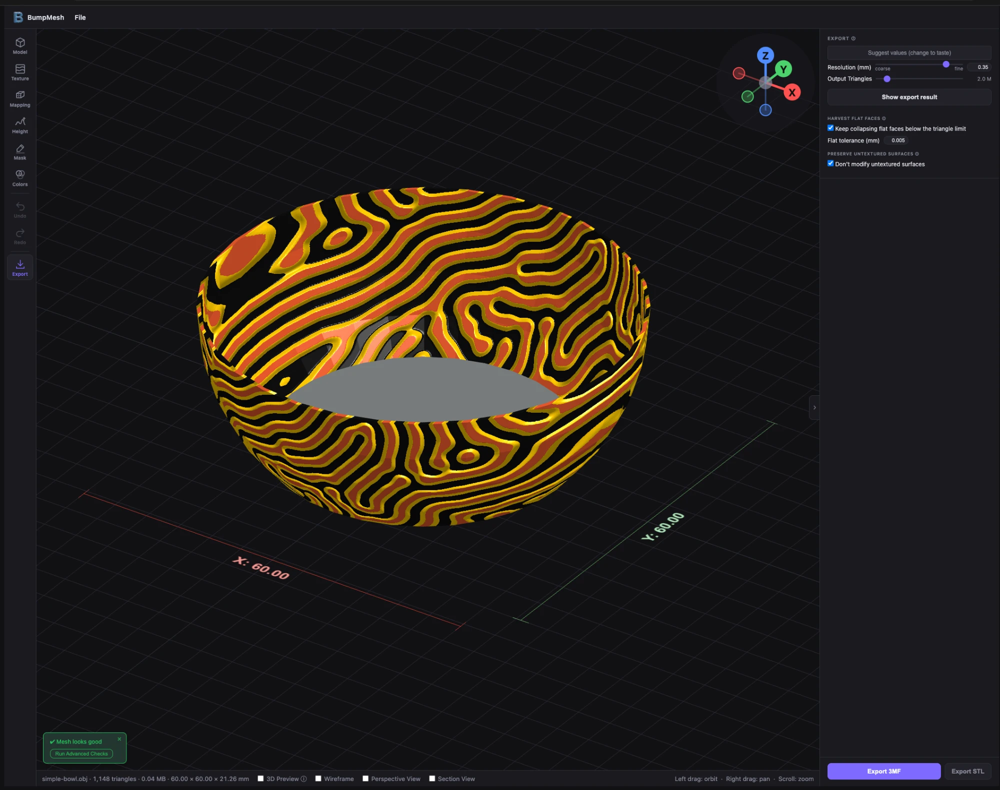

# BumpMesh – Color & GUI fork

> **This is a fork of [BumpMesh by CNC Kitchen](https://github.com/CNCKitchen/stlTexturizer)** (original author: Stefan Hermann, live at [bumpmesh.com](https://bumpmesh.com)).
>
> **Try this fork:** **https://macpit.github.io/BumpMesh/** (updated automatically on every push)
>
> If you like the fork, a ⭐ on GitHub is all I ask. To support the original author, use the [CNCKitchen.STORE](https://geni.us/CNCStoreTexture), [PayPal](https://www.paypal.me/CNCKitchen) or [Ko-fi](https://ko-fi.com/cnckitchen).



*Color by height with three filaments, shown the way the slicer will print it. Left the tool rail, top right the view gizmo, right the Export step.*

## Why a fork?

This fork adds multi-filament color painting to the 3MF export, new projection options and a reworked user interface. That is a lot of changes at once, close to a complete rework of the GUI, so it lives in its own repository where it can be tried as a whole.

Nothing here is meant to compete with the original. **If wanted, I am happy to open pull requests to [CNCKitchen/stlTexturizer](https://github.com/CNCKitchen/stlTexturizer)**, split into small, reviewable pieces (for example the 3MF color export for issue #64 on its own).

## What's different in this fork

The list grows with every change; newest first within each group.

### Filament colors (3MF)
- **Paint filaments** — paint filament 1–4 straight onto the model with a brush or fill, like the slicer's color painting (Colors step). Painted areas keep their filament whatever the automatic split does, borders are cut exactly along the brush, and the paint is saved with the project, undoable and exported in the 3MF.
- **Textured faces as their own filament** ([upstream #64](https://github.com/CNCKitchen/stlTexturizer/issues/64)) — the 3MF export paints textured faces as filament 2 and untextured faces as filament 1. Bambu Studio, OrcaSlicer and PrusaSlicer load it as multi-material painting.
- **Color by height** — up to 4 filaments split along the texture's height contours (for example green valleys, yellow ridges). Triangles are cut exactly along the contour lines, so the color borders follow the relief instead of jumping from triangle to triangle; the cut mesh stays watertight.
- **Decimation keeps the color borders** — vertices on a border between two filaments stay where they are, so the triangle count still reaches the target without the colors bleeding.
- **Thresholds and colors per band** — sliders for where each filament starts, swatches to match your actual filaments.
- **Surface shares and height histogram** — how much of the surface each filament gets, estimated from the texture before exporting.
- **Realistic preview** — the 3D preview colors the model by height the way the slicer will; "Show export result" (in the Export step) displays the exported, colored mesh itself. Threshold sliders and color swatches update the preview live while you drag.

### Projection
- **Unfold (flat faces)** — lays the texture over flat-faced parts like a box net, so the pattern runs continuously over folded edges instead of restarting on every face. Seams go where they are least visible (preferably bottom and side edges).
- **Fit seams** — adjusts tile size and offset so the pattern meets itself at the remaining seams, measured with the actual texture.
- **Rotate 90°** (Texture step, next to Invert texture) — turns the texture image itself a quarter turn per click (0°, 90°, 180°, 270°), for every projection and ornament; on a ring rolled out around the wall it moves where the ring starts.

### Ornaments
A new step in the tool rail for motifs that are placed, not tiled. Every ornament is a layer of its own.

**Three kinds**
- **Stamp** — a motif placed once (moved here from Mapping). Click the model to place it, scroll to resize.
- **Border** — the pattern repeats a whole number of times around the model as a band, like the friezes on a Greek vase. Repeats, rows (several rows stacked in the band), height and width are adjustable; "Fit to pattern" keeps the pattern's proportions.
- **Ring** — round frames and medallions. *From above* or *from below* they lie flat, centred on the axis (plates, lids, the inside of a bowl); *around the wall* rolls the ring out once (angle around, radius up, outer edge on top) as a seamless band; **Turn over (180°)** puts the inner edge on top, so figures that stand on the ring's outer edge are upright on the wall. *Over the bowl* lays the ring over the whole model from the centre of its bottom: the image radius runs along the surface up the wall (measured on the model's outer profile, `bowlProfile.js`), so nothing stretches on steep walls, and the inside and the outside carry the pattern at the same place, as if punched through. **Height lines** place it: the closed circles of the image show as coloured lines around the model; drag one to pin that circle there (the image stretches between the lines), double-click to add a line, drag one off the model to remove it. A *Bottom ↔ wall* slider spreads the image without lines. Inner and outer radius are detected from the image (`ringUnwrap.js`).

**Several at once**
- "+ Stamp", "+ Border" and "+ Ring" add each ornament as a layer of its own, shown as cards: click to fold open or shut, − removes, the arrows change the stacking.
- The upper card lies on top. Texture layers appear as slim rows, so the order relative to them is visible too.
- A covering ornament also hides the colours of the layers below it.

**Relief and size**
- **Relief:** raised, engraved, or **flat** (no height, only colour — like painted on).
- **Depth** of its own, independent of the other texture layers.
- **Thicker lines** (mm) widens the pattern's lines by an exact distance, for relief and colour alike, so thin single-line SVGs become printable.
- **Free frame** (mm) keeps a smooth margin around a stamp (or above and below a border) where the background texture stops. A flat ring covers only the ring itself, so the texture continues inside its hole and around it.

**Colour (3MF)**
- **Own filament:** the export cuts the mesh exactly along the pattern's edge; it combines with color by height and painted filaments.
- **Colour picker:** takes a free filament of its own (flat picks one automatically, since a flat ornament without one would be invisible) and warns if that filament is also used by Colors, painting or another ornament.
- **Colour spread** sets how far the colour reaches into the pattern (50 % = cut at mid grey).

**SVG patterns**
- Load an SVG as pattern (or as any texture): it is rasterised at full resolution, and on a transparent background the shapes are the relief whatever their colour. One repeat per file, seamless left to right.
- Test patterns drawn for this fork: `ornaments/maeander-test.svg` (border) and `ornaments/ring-test.svg` (ring).

### User interface
- **Menu bar** — the BumpMesh logo opens *Info* (about, what's new, license, imprint, source code of this fork and of the original, language and theme); *File* has load model (⌘/Ctrl+O), open/save project (⌘/Ctrl+S), reset to defaults and **recently used** files (kept in the browser, no upload).
- **Tool rail** on the left: Model, Texture, Mapping, Height, Mask, Colors, Undo/Redo, Export. The settings panel shows only the chosen step instead of one long list.
- **Advanced / Beta dissolved** — every option moved to the step where it acts; long explanations moved into ⓘ tooltips.
- **Export 3MF first** — 3MF is the main export button (it carries the colors), STL stays available next to it; both sit at the bottom of the Export step.
- **Scale** in the Model step, like the slicers: percent or size in mm per axis, uniform toggle, reset, and **drag handles in the 3D view** (corners scale uniformly, X/Y/Z handles per axis). The export resolution, the 3D preview and the dimensions follow the new size.
- **View gizmo** in the top right of the 3D view: click X, Y or Z to look along that axis (the faint ends show the opposite side), click the centre to return to the 3D view. Replaces the axes on the ground.
- **Clearer Mask step** — three blocks (automatically by slope, select by hand, soft transition), Brush and Fill as big tool tiles with only their own options, the include/exclude switch in plain words ("Painted stays smooth" / "Texture only where painted"), and hover help on every row, slider and button.
- **In-app dialogs** — "Reset to defaults" and deleting your own textures ask in a dialog inside the app instead of a browser pop-up, so they also work in embedded browsers that drop those pop-ups.
- **Undo/redo for model edits** — scale, rotate and place on face can be undone like any setting.
- **Start model** — a 120 mm bowl (models/bowl.obj) instead of the 50 mm cube: curved walls, an inside and a flat bottom show more of what textures, masks and colors do.
- **Cleaner screen** — no popup on export, no support banner or footer links in the sidebar, no welcome popup (Info ▸ What's New opens this README's change list in a new tab, so it is kept in one place); *License & Terms* is written for the fork (AGPL v3, original author, where questions about the fork go) instead of the original site's terms, 3D Preview moved to the viewport footer, larger footer text. The "Define cylinder projection" window shows only in the Mapping and Ornaments steps, where it is used.

### Fixes
- **Redo works again** — undo steps were compared by reference, so a redo right after an undo did nothing.
- **Switching layers keeps the texture height** — with a "Flat" ornament in the list, clicking another layer could set that layer's relief to 0 (and give the flat ornament a relief).
- **Preview matches the export** in four more places: "Rotate around Z" is shown in the editor; a hidden active layer no longer covers the layers below or shows its ornament colour; where two ornaments overlap the upper one wins in the 3MF too; the ornament colour and the height bands run right up to sharp edges instead of stopping half a triangle short.
- **Removing a layer** no longer hands its painted mask to the layer after it.
- **Paint filaments** — clicking the active filament chip a second time stops painting.
- **No seam line on borders and wall rings** — the preview no longer draws a thin grey line at the back of a border and between its rows, and a stamp seen small no longer picks up the opposite edge of its image.
- **Ring from a non-square image** — the ring's radius follows the shorter side of the image, in the preview and the export alike.
- **Border on the axis** — a ring "over the bowl" switched to a border has its centre on the axis; the pattern now runs around the wall (starting at +X) instead of collapsing into stripes.
- **Height lines** are cut by the section view like the model and disappear when the texture is removed.
- **Open meshes keep their rim** — simplifying a model with open edges (or the untextured half of one) no longer eats it away from the rim; closed models are unaffected.
- **Very dense colour exports** — the height / ornament colour cut writes into typed arrays, so it no longer fails near 15 million triangles and needs far less memory.
- **Triangle estimate on coarse CAD meshes** — edges more than 64× the target length no longer give a wrong, order-dependent count (Smart resolution, estimated triangles).
- **Advanced mesh check** — a few very large triangles next to many tiny ones no longer exhaust the memory.
- **Mirrored 3MF parts** load the right way out.
- **Ornament fields follow the model** — diameter, width and height update when a stamp is dragged on the model or resized with the wheel.
- **Height lines** — a click on a line without dragging leaves the lines as they were (automatic ones keep following the distribution slider); a double-click on an existing line no longer adds a second one on top.
- **New model** — the ornaments of every layer start over on a newly loaded model, not only the active one.
- **Start** — the page takes clicks and drops once it has finished starting, so an early click on a slow connection no longer fails.
- **Sharp on every screen** — the view follows the pixel density when the window moves to another monitor or the browser zoom changes.

### Speed
- **Ornament sliders** update the preview after a short pause while dragging, like every other slider, instead of recomputing on every tick (line growing, ring unwrap, depth map).
- **Masks** are sent to the graphics card only when a mask, a painted filament or the layer order changed, not on every preview update.
- **Picking** on models from 20,000 triangles uses a bounds tree ([three-mesh-bvh](https://github.com/gkjohnson/three-mesh-bvh)): hovering a stamp, painting and grabbing stay smooth on large meshes and in the 3D preview.
- **Height lines** follow the mouse once per frame; ring strips, grown lines and the bowl table are kept per layer setting, so two layers with the same image no longer recompute each other's maps, and replaced textures are freed.

### Hosting
- **GitHub Pages** — every push publishes the app to https://macpit.github.io/BumpMesh/. The imprint names this fork's operator, not CNC Kitchen.

---

*The original README follows.*

# BumpMesh by CNC Kitchen (original README)

**Live:** https://bumpmesh.com  
**GitHub:** https://github.com/CNCKitchen/stlTexturizer
**Author:** Stefan Hermann

A browser-based tool for applying surface displacement textures to 3D meshes — no installation required.

Load an STL, OBJ, 3MF, or STEP file, pick a texture, tune the parameters, and export a new displaced STL ready for slicing.

## Recent Updates

- **Stamp mode** (v1.5) — apply a texture once, like a logo or label, with the new Surface normal projection
- **Texture layers** (v1.4) — up to four textures on one model, with a circle brush that refines the mesh by itself
- **3Dconnexion SpaceMouse** support (v1.4.2) and **tire tread** textures (v1.4.3)
- **Section View** (v1.3.8) — texture and mask the inside of hollow parts
- **Texture Gallery** with 101 textures and saved custom uploads
- STEP import, project files, undo / redo, 3MF export and 17 languages

See the **[full changelog](https://bumpmesh.com/changelog.html)** for every update since April 2026.

## Features

### Textures
- **101 built-in seamless textures** in eight categories (geometric, patterns, organic, fabric, natural, grip, molded, tires): weaves, knurling, carbon twill, chainmail, scales, bark, wood grain, cobblestone, Japandi flutes and ripples, mold grains (sand matte, VDI spark erosion, leather, haircell), tire treads (touring, mud-terrain, truck rib, tractor, loader), Hero Patterns and more
- **Texture Gallery** — browse, search and filter the full catalogue in a side panel that takes the settings sidebar's place and stays open while you try textures on the model (click or arrow keys; the model spins on a turntable while you browse); star favorites to pin them in the panel grid, which grows by a row per 4 (saved in the browser)
- **Custom textures** — upload your own image as a displacement map, or an ideaMaker `.texture` file; uploads are kept under "Your textures" in the gallery (this browser only, and the browser may clear them at any time) where you can star, re-download or delete them
- **Texture smoothing** — configurable blur to soften the displacement map before applying

### Projection Modes
- **Triplanar** (default) — blends three planar projections based on surface normals; best for complex shapes
- **Cubic (Box)** — projects from 6 box faces with edge-seam blending and smart axis dominance
- **Cylindrical** — wraps texture around a cylindrical axis with configurable cap angle
- **Outline wrap** — wraps the texture along the part's outline around Z instead of by angle, so a regular pattern keeps its cell size and runs unbroken around the corners of box-like parts; a whole number of repeats fits every height, so it closes with no seam. Where the outline does not go around the part's centre (a C shape), it maps as Cylindrical. A texture rotation other than a multiple of 90° shows the seam
- **Spherical** — maps texture spherically around the object
- **Planar XY / XZ / YZ** — flat axis-aligned projections
- **Stamp mode** — places the texture once instead of tiling it (logos, badges, labels): click the model to position it, drag to move, scroll to resize; works with Surface normal, Planar and Cylindrical. Only the surface facing the stamp gets it, and exports refine only the faces it touches
- **Surface normal** (Stamp mode) — projects along the surface under the stamp, so it lies flat on slopes and curves

### UV & Transform Controls
- **Scale U/V** — independent or locked scaling (0.05–10×, logarithmic)
- **Offset U/V** — position the texture on each axis
- **Rotation** — rotate texture before projection
- **Seam Blend Strength** — softens hard edges where Cubic/Cylindrical projection faces meet
- **Seam Band Width** — controls blending zone width at seam edges
- **Cap Angle** (Cylindrical) — threshold for switching to top/bottom cap projection

### Displacement
- **Amplitude** — scales displacement depth from 0 % to 100 %
- **Symmetric displacement** — 50 % grey stays neutral, white pushes out, black pushes in (preserves volume)
- **3D displacement preview** — real-time GPU-accelerated preview toggle showing actual vertex displacement
- **Amplitude overlap warning** — alerts when depth exceeds 10 % of the smallest model dimension

### Texture Layers
- **Several textures on one model** — up to four layers, each with its own texture, projection, size, height and painted surface; the sidebar always edits the highlighted layer, whose surfaces show in teal while everything else is grey
- **Cover or add** — a layer covers the layers below where it is painted, or adds its relief to them
- **New layers start empty** in Include Only mode with the fill tool ready: click the surfaces the texture should cover
- Layers, their paint and their textures are saved in `.bumpmesh` projects; **Bake Textures** flattens them into the mesh when needed

### Surface Masking
- **Angle masking** — suppress texture on near-horizontal top and/or bottom faces (0°–90° threshold each)
- **Surface painting** — paint surfaces to exclude (orange) or exclusively include them
  - Circle brush, **Precision** mode (default) — refines the mesh under the stroke itself (after PrusaSlicer's paint-on tool), so the stroke edge is as fine on a 12-triangle cube as on a scan; the base mesh is never modified
  - Circle brush, **Standard** mode — marks every whole triangle the brush touches (highlighted while hovering), so a quick smudge selects the flat faces of a CAD model
  - Hardness (Precision) — a soft brush fades the mask out toward the rim for gradual texture borders
  - Single-triangle brush and bucket fill — flood-fills adjacent faces up to a configurable dihedral-angle threshold
  - Erase — hold Shift to undo painted surfaces
  - Clear all — reset the layer's paint

### Mesh Processing
- **Adaptive subdivision** — subdivides edges until they are ≤ a target length; respects sharp creases (>30° dihedral)
- **QEM decimation** — simplifies the result to a target triangle count using Quadric Error Metrics with boundary protection, link-condition checks, normal-flip rejection, and crease preservation
- **Mesh diagnostics** — automatic checks for open edges and shell count, with advanced diagnostics and overlay highlights for problem areas
- **Safety cap** — hard limit of 10 M triangles during subdivision to prevent out-of-memory

### 3D Viewer
- **Orbit / pan / zoom** controls
- **3Dconnexion SpaceMouse** — fly the view with the puck in Chrome and Edge: push/pull to zoom, slide to pan, tilt and twist to orbit (connects after the first touch of the puck). The model follows the cap; the SpaceMouse button in the bottom bar sets the speed and reverses single axes
- **Wireframe toggle** — visualise mesh topology
- **Section view** — cut the model open with a plane to see which inner surfaces (holes, cavities, the inside of hollow parts) get textured, and mask them right through the cut; X/Y/Z snap, flip, and drag handles to move or tilt the cut
- **Mesh info** — live triangle count, file size, bounding-box dimensions
- **Grid & axes indicator** — X = red, Y = green, Z = blue
- **Place on Face** — click a face to orient it downward onto the print bed

### File Support
- **.STL** — binary and ASCII
- **.OBJ** — via Three.js OBJLoader
- **.3MF** — ZIP-based format (via fflate decompression)
- **.STEP / .STP** — CAD B-rep files, tessellated in-browser by [meshStep](https://github.com/CNCKitchen/meshStep) with coarse / standard / fine quality presets

### Export
- Downloads a **binary STL** with displacement baked in
- Progress reporting through subdivision → displacement → decimation → writing stages
- Configurable edge-length threshold and output triangle limit

### Other
- **Light / Dark theme** — respects OS preference, persisted per browser
- **Multilingual** — English and German UI with auto-detection

## Usage

1. Open `index.html` in a modern browser (Chrome, Edge, Firefox, Safari).
2. Drop a model onto the viewport or click **Load STL…** (supports STL, OBJ, 3MF).
3. Select a texture preset from the sidebar (or upload a custom image).
4. Choose a projection mode and adjust UV scale, offset, rotation, and amplitude.
5. Optionally mask or exclude surfaces with the angle sliders or paint tools.
6. Click **Export STL** to download the displaced mesh.

> **Note:** All processing runs entirely in the browser — no data is uploaded to any server.

## Project Structure

```
index.html            # Main entry point
style.css             # Styles (light / dark theme)
logo.png              # Favicon & header logo
CNAME                 # Custom domain (bumpmesh.com)
textures/             # Built-in JPG/PNG displacement map images (101 textures) + thumbs/
js/
  main.js             # App bootstrap & UI wiring
  viewer.js           # Three.js scene / camera / controls
  stlLoader.js        # Binary & ASCII STL parser
  presetTextures.js   # Built-in texture presets (categories, credits, default favorites) + custom upload
  textureGallery.js   # Favorites grid + Texture Gallery side panel
  customTextures.js   # "Your textures": uploaded maps kept in this browser (IndexedDB)
  sidebarToggle.js    # Collapse / expand tab for the right-hand sidebar (settings or gallery)
  previewMaterial.js  # Three.js material for live & displacement preview
  previewPipeline.js  # 3D-preview mesh build (runs in previewWorker.js)
  mapping.js          # UV projection logic (8 modes, plus Surface normal for stamps)
  outlineWrap.js      # Outline wrap tables and places (mode 8; built in outlineWrapWorker.js)
  displacement.js     # Vertex displacement baking
  subdivision.js      # Adaptive mesh subdivision
  decimation.js       # QEM mesh decimation
  meshIndex.js        # Shared vertex welding + integer-pair hash maps
  exclusion.js        # Face exclusion / inclusion painting
  exporter.js         # Binary STL export
  i18n.js             # Translations (EN / DE)
```

## Run Locally

All processing runs entirely in the browser — no backend or build step is needed. You just need a local HTTP server because browsers block ES module imports and texture loading from `file://` URLs.

```bash
# Clone the repository
git clone https://github.com/CNCKitchen/stlTexturizer.git
cd stlTexturizer
```

Then start any static file server from the project root. Pick whichever you have installed:

**Python (3.x)**
```bash
python -m http.server 8000
```

**Python (2.x)**
```bash
python -m SimpleHTTPServer 8000
```

**Node.js (npx, no install needed)**
```bash
npx serve .
```

**PHP**
```bash
php -S localhost:8000
```

Open http://localhost:8000 in your browser and you're ready to go.

> **Tip:** Any static server will work — the app has no server-side dependencies. After updating a local copy, hard-reload once (Ctrl+F5 / Cmd+Shift+R): most simple servers don't send cache headers, so the browser may otherwise mix new and old files.

**Docker / Podman**
```bash
docker compose up -d      # or: podman-compose -f podman-compose.yaml up -d
```
Serves the app on http://localhost:8080. To change the port or container name, copy `.env.example` to `.env` and edit it.

## Dependencies

Loaded via CDN ([jsDelivr](https://www.jsdelivr.com/)) — no build step or npm install needed:

| Library | Version | License | Usage |
|---------|---------|---------|-------|
| [Three.js](https://threejs.org/) | 0.170.0 | MIT | 3D rendering, scene management, materials |
| — [OrbitControls](https://threejs.org/docs/#examples/en/controls/OrbitControls) | 0.170.0 | MIT | Camera orbit / pan / zoom |
| — [STLLoader](https://threejs.org/docs/#examples/en/loaders/STLLoader) | 0.170.0 | MIT | Binary & ASCII STL import |
| — [OBJLoader](https://threejs.org/docs/#examples/en/loaders/OBJLoader) | 0.170.0 | MIT | OBJ mesh import |
| — [LineSegments2 / LineSegmentsGeometry / LineMaterial](https://threejs.org/docs/#examples/en/lines/LineSegments2) | 0.170.0 | MIT | Wide-line wireframe overlay |
| [fflate](https://github.com/101arrowz/fflate) | 0.8.2 | MIT | ZIP compression & decompression for 3MF import/export |
| [three-mesh-bvh](https://github.com/gkjohnson/three-mesh-bvh) | 0.8.3 | MIT | Bounds tree for picking on large meshes (added by the fork) |

All dependencies are MIT-licensed.

## Texture Credits

- Textures marked **HP** in the gallery are based on [Hero Patterns](https://heropatterns.com/) by Steve Schoger, licensed under [CC BY 4.0](https://creativecommons.org/licenses/by/4.0/). The SVG patterns were rasterised and converted to seamless heightmaps.
- Textures marked **CC0** come from [ambientCG](https://ambientcg.com/) and [Poly Haven](https://polyhaven.com/) and are in the public domain (CC0 1.0). Thank you to both projects.
- Textures marked **FF** (Basket, Brick, Bubble, Crystal, Leather 2, Weave 3) were made with [Filter Forge](https://www.filterforge.com/).

## License

GNU AGPL v3.0 — see [LICENSE](LICENSE).
